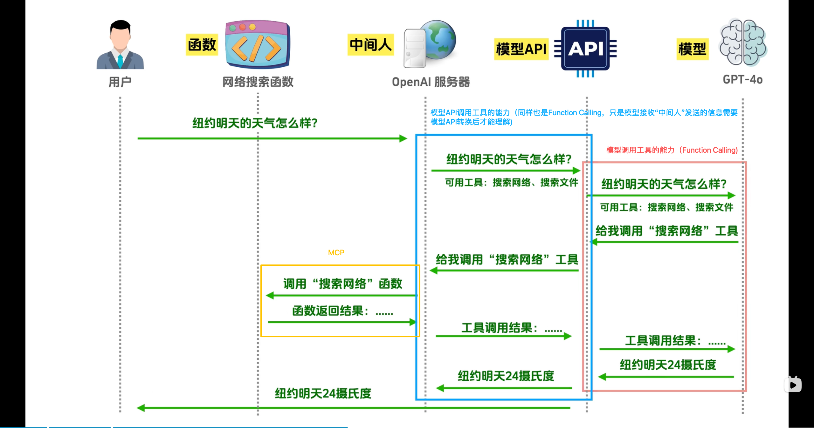
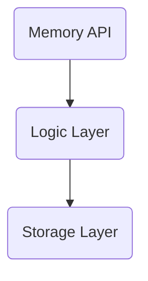

# 八股文记录

# GIL（Global Interpreter Lock）全局解释器锁

### 一句话解释

**GIL是Python的一道锁：同一时刻，一个进程里只有一个线程在执行Python字节码。**

### 为什么要加这把锁？

Python的内存管理不是线程安全的。看这个例子：

```python
a = []
# 线程1执行：a.append(1)
# 线程2执行：a.append(2)
# 线程1执行：print(len(a))  → 期望2，可能得到1
```

两个线程同时对列表操作，可能导致数据损坏。GIL就是为了简化这个问题。

### GIL的工作原理

```
┌─────────────────────────────────────┐
│              进程                    │
│  ┌────────┐  ┌────────┐  ┌────────┐  │
│  │线程1    │  │线程2   │  │线程3    │  │
│  │等待锁   │  │  执行中 │  │等待锁   │  │
│  └────────┘  └────────┘  └────────┘  │
│       ↑           ↑          ↑       │
│       └───────────┴──────────┘       │
│                    │                 │
│              ┌─────▼─────┐           │
│              │   GIL锁   │           │
│              └───────────┘           │
└─────────────────────────────────────┘
```

CPU时间片轮转，但同一时刻只有拿到GIL的线程才能执行Python代码。

### GIL的影响

| 场景 | 受影响？ | 原因 |
|------|---------|------|
| CPU密集型（计算） | ❌ 受影响 | 多线程无法并行 |
| I/O密集型（网络/文件） | ✅ 不受影响 | 等待时自动释放GIL |

```python
# CPU密集型 - GIL限制并行
def cpu_task():
    return sum(i * i for i in range(10_000_000))

# threading + GIL = 串行执行，速度和单线程差不多
# multiprocessing = 真并行（多进程绕过GIL）

# I/O密集型 - 不受影响
async def io_task():
    await fetch_data()  # 等待时GIL被释放，其他线程可以执行
```

### 面试标准回答

> GIL是Python解释器CPython中的一把全局锁，保证同一时刻只有一个线程执行Python字节码。这是因为Python的垃圾回收机制不是线程安全的。GIL的存在使得CPU密集型任务无法利用多线程真正并行，但对于I/O密集型任务影响不大，因为等待I/O时会自动释放GIL。如果需要CPU密集型并行，通常用multiprocessing代替threading。

### 常见追问

**Q: 为什么Python不去掉GIL？**
A: 去掉GIL意味着重写整个内存管理机制，工作量巨大，且会牺牲简单性。Python社区为此争论多年。

**Q: 如何绕过GIL？**
A: multiprocessing（多进程）、用C扩展写关键代码、或选择无GIL的Python实现如Jython、PyPy（Stackless）。

# asyncio(python异步编程)

**底层原理：**

asyncio是Python的协程异步I/O框架，核心基于 **事件循环(Event Loop)** 和 **协程(Coroutine)** 。

```
┌─────────────────────────────────────────────────────┐
│                    事件循环                         │
│  ┌─────────┐  ┌─────────┐  ┌─────────┐            │
│  │协程1    │  │协程2    │  │协程3    │  ...       │
│  │(等待IO) │  │(等待IO) │  │(执行中) │            │
│  └────┬────┘  └────┬────┘  └────┬────┘            │
│       │             │             │                 │
│  ←────┴─────────────┴─────────────┴────→           │
│              任务调度(单线程)                       │
└─────────────────────────────────────────────────────┘
```

**关键概念：**
- **协程(Coroutine)**：可暂停/恢复的函数，用`async def`定义
- **事件循环(Event Loop)**：调度协程执行的循环机制
- **Future/Task**：协程的包装器，代表未完成的异步操作
- **await**：暂停当前协程，等待另一个协程完成

**为什么快？**

当一个协程等待I/O（如API请求）时，事件循环会切换到其他可执行的协程，而不是阻塞等待。

### 面试问答

**Q1: asyncio为什么能提高I/O密集型任务的效率？**

**参考答案：**

asyncio通过事件循环和协程实现并发。当协程等待I/O（如网络请求）时，事件循环会自动切换到其他可执行的协程。相比于传统的多线程或同步阻塞：

1. **无线程切换开销**：协程切换是程序级别的，不需要操作系统调度
2. **避免GIL限制**：单线程内的协程切换不受Python全局解释器锁限制
3. **内存占用低**：每个协程约几KB，而每个线程约1MB

**Q2: 什么时候不适合用asyncio？**

**参考答案：**

1. **CPU密集型任务**：如图像处理、加密计算等，应该用`multiprocessing`
2. **有大量同步阻塞代码**：改造代价高
3. **需要真正的并行**：需要绑卡/科学计算等受GIL影响的场景

# @lru_cache（哈希表缓存）与单例模式

```python
# maxsize控制大小
@lru_cache(maxsize=1)
def get_settings() -> Settings:
    return Settings()

settings = get_settings()  # 全局单例
```

**@lru_cache vs 单例模式的区别：**

| 特性 | @lru_cache | 单例模式(Singleton) |
|------|------------|-------------------|
| 线程安全 | ✅ 安全 | ✅ 安全 |
| 延迟加载 | ✅ 首次调用才创建 | ✅ 首次调用才创建 |
| 可测试性 | ❌ 难以mock | ✅ 容易mock |
| 清除缓存 | 可以手动clear | 需要额外实现 |

### 面试问答

**Q1: @lru_cache(maxsize=1) 和手动实现单例有什么区别？**

**参考答案：**

功能上类似，但@lru_cache是**装饰器模式**，自动处理缓存逻辑：

```python
# @lru_cache版本
@lru_cache(maxsize=1)
def get_instance():
    return ExpensiveObject()

# 手动版本
_instance = None
def get_instance():
    global _instance
    if _instance is None:
        _instance = ExpensiveObject()
    return _instance
```

@lru_cache的优势：内置线程安全、缓存管理。但缺点是难以测试（缓存难以清除）。

**Q2: FastAPI依赖注入的yield关键字有什么用？**

**参考答案：**

`yield`用于**依赖清理/资源释放**：

```python
def get_db() -> Database:
    db = Database()
    yield db  # 返回给路由
    # 路由完成后执行这里
    db.close()  # 关闭连接
```

这类似于Java的`try-with-resources`或Go的`defer`。

# fastAPI

### 面试问答
**Q1: FastAPI 和 Flask 的区别？**

**参考答案**

- 异步：FastAPI 原生支持 async/await，Flask 需扩展
- 性能：FastAPI 接近 NodeJS，Flask 较慢
- 类型校验：FastAPI 基于 Pydantic 自动校验
- 自动文档：FastAPI 内置 Swagger/ReDoc
- 依赖注入：FastAPI 原生支持

**Q2: FastAPI 如何实现自动参数校验？**

**参考答案**

基于 Pydantic 的 BaseModel：
1. 声明类型提示（type hints）
2. FastAPI 拦截请求并解析
3. Pydantic 验证数据，不符合则返回 422
4. 验证通过才调用处理函数

**Q3: FastAPI 的性能为什么高？**

**参考答案**

- 基于 Starlette 框架（最快的 Python ASGI 框架）
- 全程异步 IO，无阻塞
- Pydantic 序列化经过 Cython 优化

**Q4: 中间件和依赖注入的区别？**

**参考答案**

| | 中间件 | 依赖注入 |
|-------|--------|----------|
| 作用范围 | 所有请求 | 特定路由 |
| 执行顺序 | 洋葱模型，进出都执行 | 注入到函数参数 |
| 用途 | 日志、认证、全局限流 | 数据库连接、业务逻辑 |
| 获取结果 | 通过response对象 | 直接作为参数传入 |

**Q5: FastAPI是如何实现自动参数类型校验的？**

**参考答案：**

FastAPI给予Pydantic的BaseModel实现自动校验。当你在函数参数中声明类型后，FastAPI会：
1. **拦截请求**：中间件捕获请求数据
2. **Pydantic验证**：调用BaseModel.parse_obj()验证数据
3. **自动转化**：如string->int转换
4. **错误处理**：验证失败返回422状态码

**Q6：为什么FastAPI性能接近NodeJS/Go？**

**参考答案：**

1. **Starlette框架**：FastAPI基于Starlette，是目前最快的Python ASGI框架之一
2. **异步IO**：全程async/await，无阻塞IO
3. **最小化序列化**：Pydantic的序列化经过Cython优化
4. **类型提示优化**：支持mypy静态检查，提前发现类型问题

# MCP与Function Calling之间的关系

### Function Calling



模型本身是无法调用工具的，**Function Calling**是模型与外部工具交互的一种能力，是模型通知**Agent**，让**Agent**去调用工具后把结果返回给模型。

满足以下条件的模型称之拥有Function Calling的能力：

1. 解析工具列表
2. 挑选工具并给出参数
3. 解析工具执行结果

# 向量空间相似度计算

``````python
import numpy as np

# 计算两个embedding的相似度
def embedding_similarity(a, b):
	return np.dot(a, b) / (np.linalg.norm(a) * np.linalg.norm(b))
``````

这是余弦相似度公式，用于计算两个向量（如词embeddings）之间的相似程度。

数学原理：
$$
\text{Cosine Similarity} = \frac{\mathbf{a} \cdot \mathbf{b}}{\|\mathbf{a}\|\|\mathbf{b}\|}
$$


- `np.dot(a, b)` — 向量 a 和 b 的点积（等于 `||a|| × ||b|| × cos(θ)`）
- `np.linalg.norm(a)` — 向量 a 的 L2 范数（长度/模）
- 同理得到 `||b||`

约分后就是 `cos(θ)`，即夹角的余弦值。

**取值范围：**

- **1.0** — 两向量方向完全相同
- **0.0** — 两向量正交（相互垂直）
- **-1.0** — 两向量方向完全相反

在 NLP/embedding 场景中常用于：计算句子相似度、语义搜索、推荐系统等。


# Agent记忆框架

|   Name   | Definition                                                   |
| :------: | :----------------------------------------------------------- |
| Text2Mem | 给所有记忆系统定义"操作指令集"，12 个原子操作 + 五元 JSON 契约 + 双层验证 |
|   Mem0   | 当下 Star 最多的记忆中间件，5 个工厂 / 双存储 / 三种记忆类型，含真实成本瓶颈分析 |
|  Letta   | 把 OS 虚拟内存思想搬进 Agent，Git 版本化记忆 + Sleeptime 异步后台学习 |
|   ReMe   | 阿里 AgentScope 出品，"文件即记忆"，记忆对用户完全透明可直接编辑 |
|   memU   | 范式最激进：让记忆本身变成一个 24/7 后台主动 Agent           |

## Text2Mem

[arxiv](https://arxiv.org/pdf/2509.11145) | [github](https://github.com/MemTensor/text2mem)

给所有的记忆系统定义一套通用的操作语言

``````tex
【用户指令】
“把我上周提到的那个会议纪要标记成重要的，30天后自动归档”

【对于记忆系统的难点问题】
“上周”：哪一段时间？
“那个会议纪要”：哪一条记录？
“标记成重要”：改权重？改标签？加提醒？
``````

Text2Mem基于3个挑战提出解法**IR中间表示层**：

- **挑战1:自然语言指令欠约束**。人类语言模糊性无法直接映射到存储操作
- **挑战2:记忆操作碎片化**。各系统各自为政，无统一操作接口
- **挑战3:意图与执行缺稳定契约**。LLM输出与存储语义之间没有可靠中间层

### Text2Mem三层架构

``````mermaid
graph TD
B(LLM/Agent) --> C(IR中间表示层)
C --> D(SQLite Postgres Milvus)
``````

- **LLM/Agent:**自然语言指令发起方
- **IR中间表示层:**12个原子操作，规定操作集和格式，不规定底层实现
- **SQLite Postgres Milvus:**Storage Backend

### 12个原子操作，三阶段覆盖记忆全生命周期

| State  | Name | Operation                                                    |
| :----: | :--: | ------------------------------------------------------------ |
| 一阶段 | ENC  | encode（记忆诞生）                                           |
| 二阶段 | RET  | Retrieve（纯数据取回）、Summarize（LLM摘要生成）             |
| 三阶段 | STO  | Label（打标签）、Update（更新内容）、Promote（提升权重）、Demote（降低权重）、Merge（合并记忆）、Split（拆分记忆）、Delete（删除记忆）、Expire（设置过期）、Lock（锁定记忆） |

### 五元JSON契约结构

Text2Mem将所有操作都整理成**JSON**结构，<u>五个字段=一纸公文</u>

````json
{
  "stage": "STO",
  "op": "Update",
  "target": {"ids": ["mem_01"]},
  "args": {"text": "..."},
  "meta": {"actor": "agent", ...}
}
````

- stage 阶段

- op 操作名
- target 目标
- args 参数
- meta 元数据
- - 体现工程成熟度的硬性规则，二选一，少一个都不让过--安全守卫参数：dry_run、confirmation，
  - dry_run 模拟执行，不写入
  - confirmation 显式确认，才放行

### 双层验证架构

- **[外层]JSON Schema:**Draft 2020-12标准，allOf + if/then条件约束，验证字段格式、类型、必填项
- **[里层]Pydantic v2：**@model_validator装饰器，阶段-操作守卫、互斥参数、安全不变量拦截

### Lock四种模式

Text2Mem的设计哲学是不信任LLM，但能兜住LLM

**记忆访问控制的精细化治理**

- **read_only（完全冻结）：**禁止一切写操作
- **no_delete（禁删）：**允许更新，禁止删除
- **append_only（只允许追加）：**只增不改不删
- **custom（完全可编程）：**allow/deny + reviewer

### 面试问答

**Q1:为什么要把Retrieve和Summarize分开？**

**参考答案**

Retrieve操作（无LLM推理、可缓存、短超时策略）通常只需要几十毫秒，而Summarize操作（完整LLM推理、token成本、长超时策略）背后是一次完整的LLM推理往往延迟是Retrieve操作的上千倍。分成两个操作，执行引擎就可以用完全不同的超时、缓存、降级策略。

**Q2:Text2Mem目前的短板是什么？**

**参考答案**

- 存储只有SQLite参考实现，无生产级存储适配
- 没有HTTP API，缺少远程调用接口
- 向量以JSON文本存在TEXT列里
- 更多是定义行业标准，但成为标准是另一回事

**Q3：记忆访问控制中reviewer机制是什么？**

**参考答案**

通过RBAC锁绕过实现reviewer机制。**RBAC（基于角色的访问控制）** 是一种常见的安全机制，通过分配角色来控制用户对资源的访问权限  。"锁绕过"通常指绕过安全检查的技术手段。 

## Mem0

[github](https://github.com/mem0ai/mem0)

### 适用场景

**用户维度·对话粒度·中低频写入**

- AI对话助手
- 客服系统
- 医疗健康追踪



- **Memory API:**Memory / AsyncMemory / MemoryClient
- **Logic Layer:**LLM 推理 + 向量检索 + 图谱构建 + Rerank
- **Storage Layer：**向量存储（22种）/ 图存储（4种） / SQLite

### 5个工厂模式--插件化架构的工厂精髓

| Factory            | Pattern          |
| ------------------ | ---------------- |
| LLMFactory         | 17+LLM提供商     |
| EmbeddingFactory   | 11+Embedding模型 |
| VectorStoreFactory | 22+向量存储      |
| GraphStoreFactory  | 4图存储          |
| RerankerFactory    | 5Reranker        |

**`importlib`**动态加载--未安装的依赖不会报错，按需导入

### 三种记忆类型

Mem0在代码里显示定义的记忆分类

- **语义记忆（Semantic）：**抽象的事实性知识
- **情景记忆（Episodic）：**具体事件的完整记录
- **程序记忆（Procedural）：**Agent执行的完整步骤

## LETTA

[arxiv](https://arxiv.org/pdf/2310.08560) | [github](https://github.com/byliu-labs/MemGPT)

Letta是目前开源里记忆自洽能力最强的系统

- 2023.10 MemGPT论文发布

- 2024.09 正式更名为Letta

- 架构升级内容：

- - -移除荣誉设计

  - +新增Stateful Agent架构
  - +同名公司Letta成立

### 三层记忆架构

````mermaid
graph TD
A(Core Memory) --> B(Archival Memory)
B --> C(Recall memory)
````

- **Core memory:**核心内存，嵌入系统prompt，每次推理可见。**OS类比RAM**
- **Archival Memory：**归档内存，容量无限，向量检索。**OS类比磁盘**
- **Recall Memory：**召回内存，历史对话信息存储。**OS类比日志**

### Core Memory Block三元组

````xml
[memory_blocks XML结构]
<memory_blocks>
  <human>
    <description>...</description>
    <metadata>
      chars_current=142
      chars_limit=100000
    </metadata>
  </human>
  </memory_blcoks>
````

- **label:**路径命名空间`/memories/user_preferences`
- **description:**功能描述，存储用户偏好信息
- **value:**实际内容`First name: Alice\nOccupation: ..`
- **limit:**字符上限`100,000 chars`

### 总结

如果Mem0是中间件，那么Letta就是系统。

## ReMe

[arxiv](https://arxiv.org/pdf/2512.10696) | [github](https://github.com/agentscope-ai/ReMe)


# PostgresSaver与PostgresStore的区别

|            | PostgresSaver                                         | PostgresStore                                     |
| ---------- | ----------------------------------------------------- | ------------------------------------------------- |
| 用途       | 检查点(**CheckPointer**)                              | 存储(**Store**)                                   |
| 持久化内容 | Agent的**图执行状态**（对话历史、变量值、当前节点等） | **自定义业务数据**（如用户资料、偏好设置等）      |
| 类比       | 游戏存档（保存进度）                                  | 数据库表（存储业务数据）                          |
| 生命周期   | 用于**恢复/跨会话继续**对话                           | 用于**长期存储**结构化数据                        |
| 访问方式   | LangGraph自动管理，StateGraph内部使用                 | 需要通过`.put()` / `.get()` / `.delete()`手动读写 |

``````python
# 代码举例
checkpointer = PostgresSaver(db_connection_pool)	# 保存图执行状态，用于多轮对话恢复
store = PostgresStore(db_connection_pool, index={"dims": 1536, "embed": llm_embedding})	# 存储业务数据，支持向量索引搜索
``````

**简单说：**Saver负责“记住对话走到哪了”，Store负责“存取你的业务数据“

